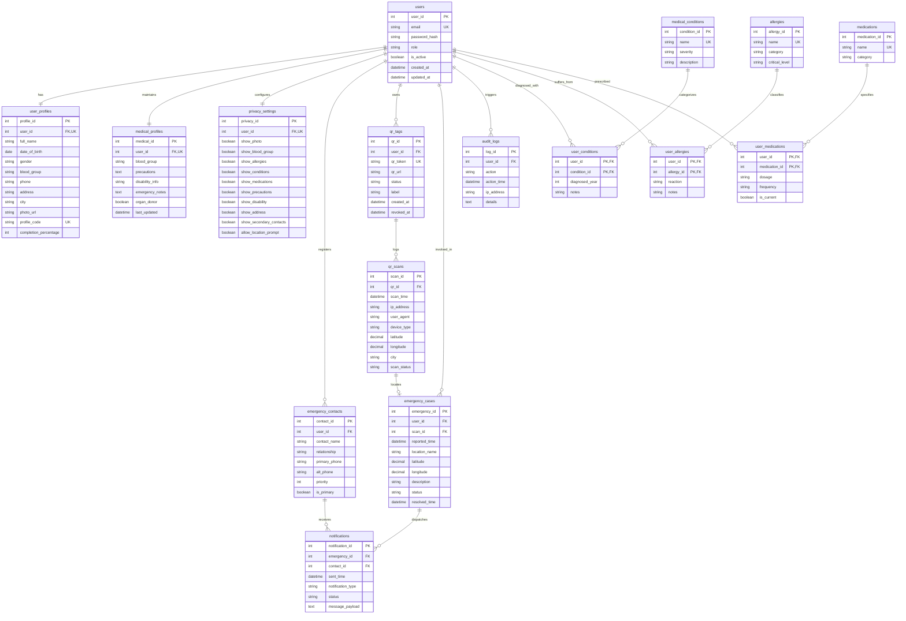

# LIFETAG — Entity-Relationship (ER) Diagram & Data Dictionary
## Database: `lifetag_db` (MySQL 8.0)

---

## 1. Entity-Relationship (ER) Diagram

---

## 2. Complete Data Dictionary

### Table 1: `users`
| Column Name | Data Type | Nullable | Key | Default | Description |
| :--- | :--- | :---: | :---: | :---: | :--- |
| `user_id` | INT | NO | PK | AUTO_INCREMENT | System unique user identifier |
| `email` | VARCHAR(100) | NO | UK | None | User login email address |
| `password_hash` | VARCHAR(255) | NO | None | None | Bcrypt hashed password string |
| `role` | ENUM('USER','ADMIN')| NO | None | 'USER' | System authorization role |
| `is_active` | BOOLEAN | NO | None | TRUE | Account activity status flag |
| `created_at` | DATETIME | NO | None | CURRENT_TIMESTAMP | Account registration timestamp |
| `updated_at` | DATETIME | NO | None | CURRENT_TIMESTAMP | Last account credential update |

### Table 2: `user_profiles`
| Column Name | Data Type | Nullable | Key | Default | Description |
| :--- | :--- | :---: | :---: | :---: | :--- |
| `profile_id` | INT | NO | PK | AUTO_INCREMENT | Profile record identifier |
| `user_id` | INT | NO | UK, FK | None | References `users(user_id)` ON DELETE CASCADE |
| `full_name` | VARCHAR(100) | NO | None | None | Full legal patient/rider name |
| `date_of_birth` | DATE | NO | None | None | Date of birth (age computed via stored function) |
| `gender` | ENUM(...) | NO | None | 'Prefer not to say' | Gender identity |
| `blood_group` | VARCHAR(5) | NO | None | None | Blood group (A+, A-, B+, B-, AB+, AB-, O+, O-) |
| `phone` | VARCHAR(20) | NO | None | None | Primary telephone number |
| `address` | VARCHAR(255) | YES | None | NULL | Residential address |
| `city` | VARCHAR(80) | YES | None | NULL | City / geographic area |
| `photo_url` | VARCHAR(255) | YES | None | NULL | Path to uploaded profile image |
| `profile_code`| VARCHAR(30) | NO | UK | None | Formatted public code (e.g. 'LT-00001') |
| `completion_percentage` | INT | NO | None | 40 | Profile completeness score (0-100) |

### Table 3: `medical_profiles`
| Column Name | Data Type | Nullable | Key | Default | Description |
| :--- | :--- | :---: | :---: | :---: | :--- |
| `medical_id` | INT | NO | PK | AUTO_INCREMENT | Medical record identifier |
| `user_id` | INT | NO | UK, FK | None | References `users(user_id)` ON DELETE CASCADE |
| `blood_group` | VARCHAR(5) | NO | None | None | Confirmed blood group |
| `precautions` | TEXT | YES | None | NULL | Clinical precautions (e.g., Asthma inhaler location) |
| `disability_info` | VARCHAR(255) | YES | None | NULL | Physical mobility or sensory notes |
| `emergency_notes` | TEXT | YES | None | NULL | General first-aid guidance |
| `organ_donor` | BOOLEAN | NO | None | FALSE | Organ donation consent flag |

### Table 4: `allergies` (Master Catalog)
| Column Name | Data Type | Nullable | Key | Default | Description |
| :--- | :--- | :---: | :---: | :---: | :--- |
| `allergy_id` | INT | NO | PK | AUTO_INCREMENT | Master allergen identifier |
| `name` | VARCHAR(100) | NO | UK | None | Allergen name (e.g., Penicillin, Peanuts) |
| `category` | ENUM(...) | NO | None | 'Other' | Category ('Food', 'Drug', 'Environmental', 'Insect') |
| `critical_level`| ENUM(...) | NO | None | 'Severe' | Clinical severity ('Mild', 'Moderate', 'Severe', 'Anaphylactic') |

### Table 5: `user_allergies` (M:N Association)
| Column Name | Data Type | Nullable | Key | Default | Description |
| :--- | :--- | :---: | :---: | :---: | :--- |
| `user_id` | INT | NO | PK, FK | None | References `users(user_id)` ON DELETE CASCADE |
| `allergy_id` | INT | NO | PK, FK | None | References `allergies(allergy_id)` |
| `reaction` | VARCHAR(255) | YES | None | NULL | Observed reaction (e.g., Anaphylaxis, Skin rash) |
| `notes` | VARCHAR(255) | YES | None | NULL | Specific avoidance instructions |

### Table 6: `emergency_contacts`
| Column Name | Data Type | Nullable | Key | Default | Description |
| :--- | :--- | :---: | :---: | :---: | :--- |
| `contact_id` | INT | NO | PK | AUTO_INCREMENT | Contact identifier |
| `user_id` | INT | NO | FK | None | References `users(user_id)` ON DELETE CASCADE |
| `contact_name` | VARCHAR(100) | NO | None | None | Contact person full name |
| `relationship` | VARCHAR(50) | NO | None | None | Relationship (Parent, Spouse, Sibling, Friend) |
| `primary_phone` | VARCHAR(20) | NO | None | None | Main telephone number for one-tap calling |
| `alt_phone` | VARCHAR(20) | YES | None | NULL | Secondary telephone number |
| `priority` | INT | NO | None | 1 | Calling sequence priority (1, 2, 3...) |
| `is_primary` | BOOLEAN | NO | None | FALSE | Primary target flag |

### Table 7: `qr_tags`
| Column Name | Data Type | Nullable | Key | Default | Description |
| :--- | :--- | :---: | :---: | :---: | :--- |
| `qr_id` | INT | NO | PK | AUTO_INCREMENT | QR record identifier |
| `user_id` | INT | NO | FK | None | References `users(user_id)` ON DELETE CASCADE |
| `qr_token` | VARCHAR(64) | NO | UK | None | Cryptographic non-guessable token (e.g. 'LT-SUDHA-A1B2C3') |
| `qr_url` | VARCHAR(255) | NO | None | None | Public emergency web URL |
| `status` | ENUM(...) | NO | None | 'Active' | Tag status ('Active', 'Revoked', 'Lost', 'Inactive') |
| `label` | VARCHAR(50) | NO | None | 'Helmet Tag'| User-friendly label for sticker placement |
| `created_at` | DATETIME | NO | None | CURRENT_TIMESTAMP | Tag creation timestamp |
| `revoked_at` | DATETIME | YES | None | NULL | Revocation timestamp if deactivated |

### Table 8: `qr_scans`
| Column Name | Data Type | Nullable | Key | Default | Description |
| :--- | :--- | :---: | :---: | :---: | :--- |
| `scan_id` | INT | NO | PK | AUTO_INCREMENT | Scan log identifier |
| `qr_id` | INT | NO | FK | None | References `qr_tags(qr_id)` ON DELETE CASCADE |
| `scan_time` | DATETIME | NO | None | CURRENT_TIMESTAMP | Timestamp when QR code was scanned |
| `ip_address` | VARCHAR(45) | YES | None | NULL | Scanner IP address |
| `user_agent` | VARCHAR(255) | YES | None | NULL | Scanner browser/device User-Agent string |
| `device_type` | VARCHAR(50) | NO | None | 'Mobile' | Detected device (iPhone, Android, Desktop) |
| `latitude` | DECIMAL(10,7)| YES | None | NULL | GPS latitude (recorded only with scanner consent) |
| `longitude` | DECIMAL(10,7)| YES | None | NULL | GPS longitude (recorded only with scanner consent) |
| `city` | VARCHAR(100) | YES | None | NULL | Geocoded city or location string |
| `scan_status` | ENUM(...) | NO | None | 'SUCCESS' | Scan outcome ('SUCCESS', 'BLOCKED', 'FLAGGED') |
